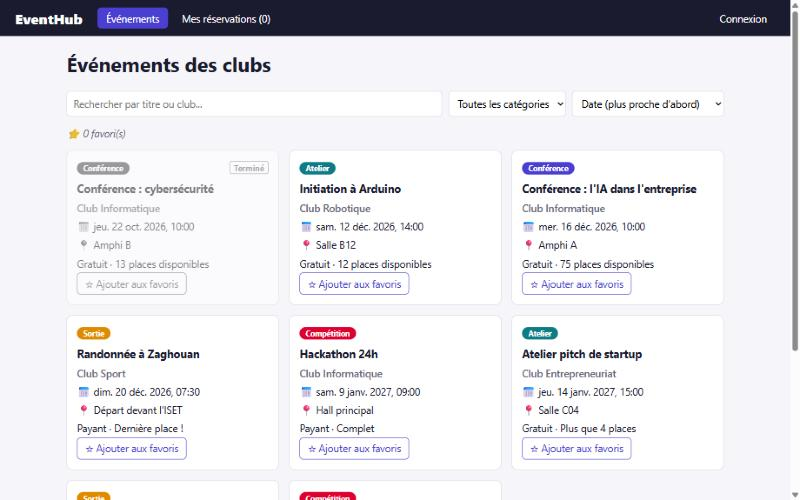
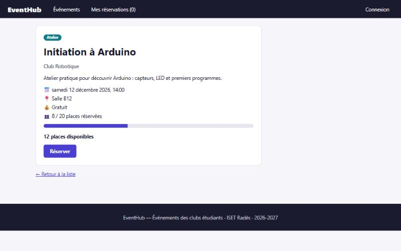
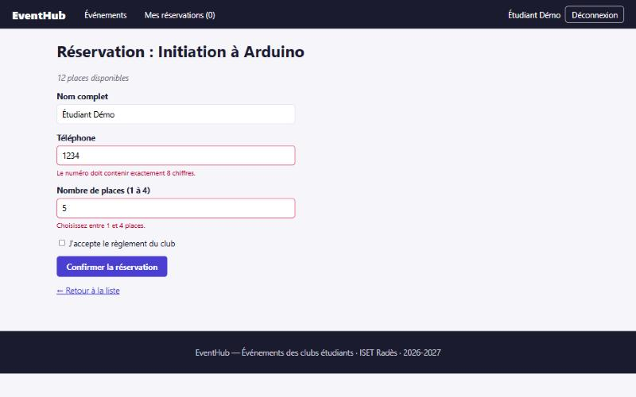
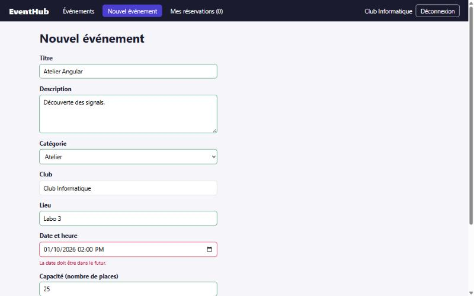

# EventHub

Plateforme de gestion et de réservation des événements des clubs étudiants.
Mini-projet du module « Développement côté client – Angular 22 » (ISET Radès, 2026-2027).

## Lancement

```bash
npm install
ng serve
```

Puis ouvrir http://localhost:4200. Vérification de la compilation : `ng build`.

## Comptes de démonstration

| Identifiant      | Mot de passe | Rôle         |
| ---------------- | ------------ | ------------ |
| etudiant@iset.tn | etudiant123  | etudiant     |
| club@iset.tn     | club123      | organisateur |

L'authentification est simulée côté client : le service `Session` garde l'utilisateur connecté en
mémoire. Ce n'est pas une vraie sécurité (les mots de passe sont dans le code et un utilisateur peut
contourner les guards) : dans une vraie application, la vérification se ferait sur un serveur.

## Exigences réalisées

| Exigence | Description                                                                   | État       |
| -------- | ----------------------------------------------------------------------------- | ---------- |
| EF-01    | En-tête, `router-outlet`, pied de page chargé avec `@defer (on viewport)`     | ✅ Réalisé |
| EF-02    | Liste en cartes `carte-evenement`, `@for`/`@empty`, badge `@switch`, favoris  | ✅ Réalisé |
| EF-03    | Recherche, filtre, tri ; pipes `filtreEvenements`, `triEvenements`, `etatPlaces` | ✅ Réalisé |
| EF-04    | Détail via `withComponentInputBinding()`, barre de remplissage                | ✅ Réalisé |
| EF-05    | Connexion (formulaire réactif), `authGuard`, `organisateurGuard`, retour      | ✅ Réalisé |
| EF-06    | Réservation, validateurs `nomComplet` et `placesDisponibles`                  | ✅ Réalisé |
| EF-07    | Mes réservations, annulation, compteur de l'en-tête                           | ✅ Réalisé |
| EF-08    | Création d'un événement, validateur `dateFuture`, redirection                 | ✅ Réalisé |
| EF-09    | Page 404 (route joker `**` en dernier)                                        | ✅ Réalisé |
| EF-10    | Bonus                                                                         | ⏳ Aucun pour l'instant |

## Organisation du code

```
src/app/
├── app.ts | app.html | app.routes.ts | app.config.ts
├── modeles/      evenement.ts, reservation.ts, utilisateur.ts
├── donnees/      evenements.ts (8 événements), comptes.ts (comptes de démonstration)
├── services/     evenements.ts, reservations.ts, session.ts
├── guards/       auth-guard.ts, organisateur-guard.ts
├── validateurs/  nom-complet.ts, places-disponibles.ts, date-future.ts
├── pipes/        filtre-evenements.ts, tri-evenements.ts, etat-places.ts
├── composants/   en-tete, pied-page, carte-evenement, badge-categorie
└── pages/        liste, detail, reservation, mes-reservations, nouvel-evenement, connexion, introuvable
```

- Les composants ne lisent jamais les données directement : tout passe par les services (ET-05).
- L'état partagé est dans des signals privés exposés avec `asReadonly()` (ET-06).
- Les tableaux sont mis à jour sans les modifier (`[...l, x]`, `filter`, `map`) (ET-07).

## Jeu de données

8 événements couvrant les 4 catégories, dont :

- « Hackathon 24h » : complet ;
- « Randonnée à Zaghouan » : une seule place restante ;
- « Conférence : cybersécurité » : déjà passé.

## Captures d'écran

| Liste                        | Détail                        |
| ---------------------------- | ----------------------------- |
|    |   |

| Réservation                             | Création                         |
| --------------------------------------- | -------------------------------- |
|   |  |

## Difficultés rencontrées

- Le validateur `placesDisponibles` a besoin du nombre de places restantes, qui n'est connu qu'une fois
  l'identifiant reçu de l'URL. Il est donc ajouté dans `ngOnInit()` avec `addValidators()`.
- Les données sont en mémoire : un rechargement de la page (F5) remet l'application à zéro.
